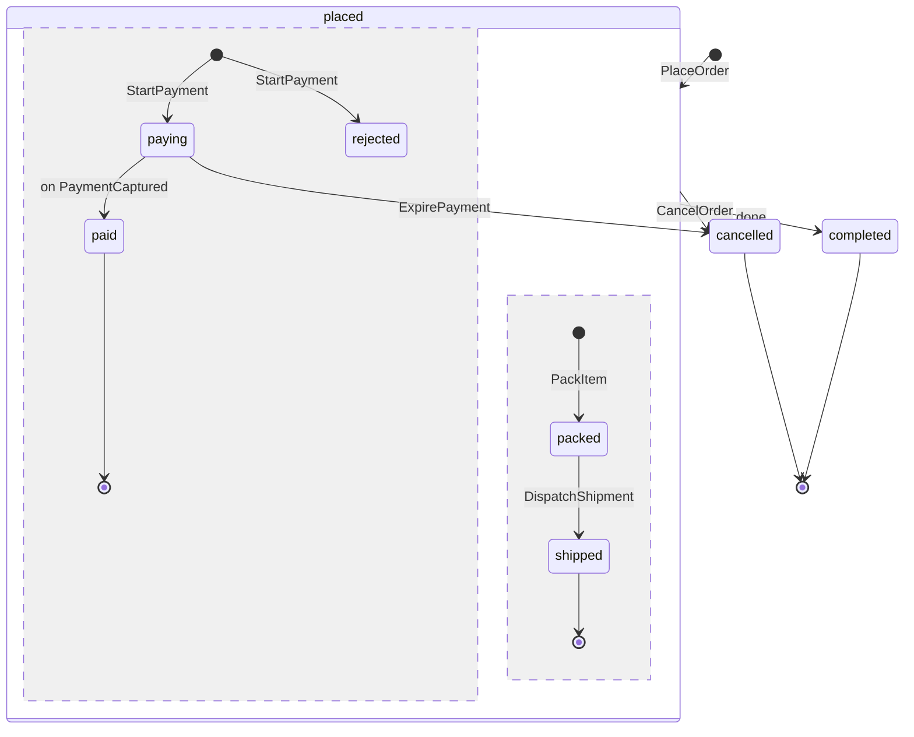

# Sourced — Stream-less Event Sourcing

Sourced is a Ruby library for aggregateless, stream-less event sourcing. Events go into a flat, globally-ordered log. Consistency context is assembled dynamically by querying relevant facts via key-value pairs extracted from event payloads, rather than being pre-assigned to fixed streams.

[](https://www.rubyforum.org/tag/sourced)

## Core Concepts

- **No streams or aggregates** — all messages share a single append-only log with auto-increment positions.
- **Partitioning by attributes** — reactors declare which payload attributes define their consistency boundary (e.g. `partition_by :course_id`). The store uses these to build query conditions and claim work.
- **Decide → Evolve → React** — reactors handle commands, evolve context from history, and react to events.
- **Optimistic concurrency** — reads return a `ConsistencyGuard` that detects conflicting writes at append time.

## Messages

Messages have no `stream_id` or `seq` — they get a global `position` when stored.

```ruby
# Define base classes for your domain (optional but recommended)
class MyEvent < Sourced::Event; end
class MyCommand < Sourced::Command; end

# Define typed messages with payload attributes
CreateCourse = MyCommand.define('courses.create') do
  attribute :course_id, String
  attribute :course_name, String
end

CourseCreated = MyEvent.define('courses.created') do
  attribute :course_id, String
  attribute :course_name, String
end
```

Attributes are declared with **native Ruby types**. The store's codec turns values into
JSON and back:

```ruby
CourseScheduled = MyEvent.define('courses.scheduled') do
  attribute :course_id, String
  attribute :starts_on, Date         # stored as "2026-01-02"
  attribute :published_at, Time      # stored as ISO 8601, microseconds kept
  attribute :level, Types::Symbol    # stored as "beginner"
  attribute :price, Types::Decimal   # stored as "19.99", precision kept
end

event = CourseScheduled.new(payload: { starts_on: Date.new(2026, 1, 2), ... })
store.append(event)

messages, = store.read(CourseScheduled.to_conditions(course_id: 'c1'))
messages.first.payload.starts_on   # => #<Date 2026-01-02>
```

See [Codecs](#codecs) for the types covered out of the box and how to add your own.

### Message features

- **Auto-generated UUIDs** for `id`, `causation_id`, and `correlation_id`
- **Causal tracing** via `#correlate(other_message)` — sets `causation_id` and `correlation_id`
- **Auto-indexed keys** — `#extracted_keys` returns `[["course_id", "c1"], ["course_name", "Algebra"]]` from payload attributes, used by the store to index messages for querying
- **Registry** — `Sourced::Message.registry` indexes defined types. Use `.from(type: "courses.created", payload: {...})` to instantiate from a type string.
- **Typed payloads** — Plumb/Types DSL for attribute coercion and validation

## Store

`Sourced::Store` is an SQLite-backed store (via Sequel) providing the flat message log, key-pair indexing, and consumer group management.

```ruby
require 'sequel'

db = Sequel.sqlite('my_app.db')
store = Sourced::Store.new(db)
store.install!                 # creates the tables and sets WAL mode (idempotent; apps use a migration, see Database setup)
store.message_codec.compile!   # what Sourced does when it boots
```

### Appending messages

```ruby
cmd = CreateCourse.new(payload: { course_id: 'c1', course_name: 'Algebra' })
position = store.append(cmd)  # returns the assigned position
```

### Reading with query conditions

```ruby
# Build conditions for a specific course
conditions = CourseCreated.to_conditions(course_id: 'c1')
# => [QueryCondition('courses.created', attrs: { course_id: 'c1' })]

# Read matching messages
result = store.read(conditions)
result.messages  # => [PositionedMessage, ...]
result.guard     # => ConsistencyGuard (for optimistic concurrency)
```

### Optimistic concurrency

```ruby
result = store.read(conditions)

# ... later, append with conflict detection
store.append(new_events, guard: result.guard)
# raises Sourced::ConcurrentAppendError if conflicting messages
# were appended after the read
```

### Delayed messages

Scheduling is transparent: stamp a message with a future time via `#at(time)` and just `append` it. `append` is the single write path — a message dated in the future is deferred to a separate `sourced_scheduled_messages` table and promoted into the main log when its time passes; a message dated now or in the past is appended immediately.

```ruby
cmd = SendReminder.new(payload: { course_id: 'c1' }).at(Time.now + 3600)
store.append(cmd)  # created_at in the future → deferred, not appended for immediate consumption

# Normally the scheduled_messages.poller component promotes due messages
# automatically. In tests or scripts, do it manually:
store.update_schedule!  # => number of messages promoted
```

There is no separate scheduling method — appending a future-dated message *is* scheduling it. In a reaction handler, `dispatch(Cmd, ...).at(time)` produces a future-dated message, so the same `append` pipeline schedules it — see [Reactions](#reactions).

### Partition reads

`read_partition` uses AND semantics — a message is included only when every partition attribute it declares matches the given value.

```ruby
result = store.read_partition(
  { course_id: 'c1' },
  handled_types: ['courses.created', 'courses.enrolled']
)
```

### Browsing the global log

`read_all` paginates the entire message log, without requiring query conditions or partition attributes. It returns a `ReadAllResult` with `messages` and `last_position` (the current max position in the store), so clients know whether more pages exist.

```ruby
# First page (default limit: 50, ascending order)
result = store.read_all(limit: 20)
result.messages       # => [PositionedMessage, ...]
result.last_position  # => 100 (max position in the store)

# Next page — pass the last message's position as cursor
result = store.read_all(from_position: result.messages.last.position, limit: 20)

# Check if there are more pages
has_more = result.messages.any? && result.messages.last.position < result.last_position

# Destructuring is also supported
messages, last_position = store.read_all(limit: 20)
```

Use `order: :desc` for reverse-chronological browsing (newest first). Pagination works the same way — `from_position` fetches messages *before* the given position.

```ruby
result = store.read_all(order: :desc, limit: 20)

# Next page of older messages
result = store.read_all(from_position: result.messages.last.position, order: :desc, limit: 20)
```

#### Iterating all messages with `to_enum`

`ReadAllResult#to_enum` returns a lazy `Enumerator` that transparently fetches subsequent pages as you iterate, using the same `order` and `limit` from the original query.

```ruby
# Iterate all messages in pages of 50
store.read_all(limit: 50).to_enum.each do |msg|
  puts "#{msg.position}: #{msg.type}"
end

# Works with Enumerable methods
store.read_all(order: :desc, limit: 100).to_enum.map(&:type)

# Supports lazy enumeration — stops fetching pages once satisfied
store.read_all(limit: 20).to_enum.lazy.select { |m|
  m.type == 'courses.created'
}.first(5)
```

## Reactors

Sourced provides four reactor base classes that share the same lifecycle (claim → evolve → handle → append → ack) and the same consumer-group machinery:

- [Deciders](#deciders) — handle commands, enforce invariants, produce events
- [Projectors](#projectors) — build read models by consuming events
- [Durable workflows](#durable-workflows) — imperative orchestrations whose steps are memoised across re-entries
- [Machines](#machines) — statecharts: commands accepted per state, parallel regions, timers and child machines

Any reactor can produce follow-up messages via [Reactions](#reactions), and run side effects via [Sync and after-sync blocks](#sync-and-after-sync-blocks).

### Deciders

Deciders handle commands, enforce invariants, and produce events. They rebuild context from event history before each decision.

```ruby
class CourseDecider < Sourced::Decider
  # Defines the consistency boundary
  partition_by :course_name

  # Initial context factory (takes no arguments)
  context do
    { name_taken: false }
  end

  # Evolve context from events (rebuilds history).
  # Evolve blocks run in the reactor's projection, not the reactor itself:
  # see Projections below.
  evolve CourseCreated do |context, _event|
    context[:name_taken] = true
  end

  # Command handler — enforce invariants, then produce events
  command CreateCourse do |context, cmd|
    raise "Course '#{cmd.payload.course_name}' already exists" if context[:name_taken]

    event CourseCreated,
      course_id: cmd.payload.course_id,
      course_name: cmd.payload.course_name
  end
end
```

#### Synchronous command handling

`Sourced.handle!` loads history, runs the decider, appends the command + events, and advances the decider's consumer group offset so workers skip the command — all in one call and one transaction. Designed for web controllers. It uses `Sourced.store`, so Sourced must be started (or pass `store:`).

```ruby
cmd = CreateCourse.new(payload: { course_id: 'c1', course_name: 'Algebra' })
cmd, decider, events = Sourced.handle!(CourseDecider, cmd)

if cmd.valid?
  # Success — events were appended
else
  # Validation failure — cmd.errors has details
end
```

Raises `Sourced::ConcurrentAppendError` on conflicts, or `RuntimeError` on domain invariant violations (e.g. "Course already exists"). For a reactor registered with `Sourced.register` whose consumer group isn't in the store yet (Sourced not started, or a `store:` it isn't registered in), it raises `Sourced::ConsumerGroupNotRegisteredError` without appending the command: silently not advancing the offset would have a worker decide the command again later.

#### CommandContext

`Sourced::CommandContext` is a factory for building Sourced commands from raw Hash attributes (e.g. HTTP params), injecting defaults like `metadata`. It mirrors `Sourced::CommandContext` but without `stream_id`, since Sourced messages are stream-less.

```ruby
# In a web controller, build a context with shared metadata
ctx = Sourced::CommandContext.new(
  metadata: { user_id: session[:user_id] }
)

# Build from a type string + payload hash (e.g. from JSON params)
cmd = ctx.build(type: 'courses.create', payload: { course_id: 'c1', course_name: 'Algebra' })
cmd.metadata[:user_id] # => session[:user_id]

# Or pass an explicit command class
cmd = ctx.build(CreateCourse, payload: { course_id: 'c1', course_name: 'Algebra' })
```

String keys are automatically symbolized, so `ctx.build('type' => '...', 'payload' => { ... })` works too.

##### Callback hooks (`on` and `any`)

Subclass `CommandContext` and register class-level hooks to enrich or transform commands at build time — e.g. injecting session data or adding metadata from the request scope.

- **`on(MessageClass, ...)`** — runs for one or more command types. Multiple `on` calls for the same class accumulate (all blocks run in registration order).
- **`any`** — runs for all commands (multiple blocks allowed, executed in order)

Both receive the `app` scope and the command, and must return the (possibly modified) command. `on` blocks run before `any` blocks. Blocks are evaluated in the context of the `CommandContext` instance, so they can call private helper methods defined on the subclass.

```ruby
class AppCommandContext < Sourced::CommandContext
  # Enrich a specific command with data from the app scope
  on CreateCourse do |app, cmd|
    cmd.with_payload(created_by: app.current_user.id)
  end

  # Same block for multiple command types
  on EnrolStudent, DropStudent do |app, cmd|
    cmd.with_metadata(campus: app.current_campus)
  end

  # Additional block for EnrolStudent — both blocks run in order
  on EnrolStudent do |app, cmd|
    cmd.with_metadata(enrolment_source: 'web')
  end

  # Add metadata to every command
  any do |app, cmd|
    cmd.with_metadata(
      request_id: app.request_id,
      session_id: app.session_id
    )
  end
end
```

Pass the request-scoped `app` object at construction time:

```ruby
# In a web controller
ctx = AppCommandContext.new(
  metadata: { user_id: session[:user_id] },
  app: self  # e.g. Sinatra app instance, Rack env wrapper, etc.
)

cmd = ctx.build(type: 'courses.create', payload: { course_id: 'c1', course_name: 'Algebra' })
cmd.metadata[:request_id]  # => set by the `any` hook
```

`app` defaults to `nil`, so existing callers without hooks are unaffected. Hooks are inherited by subclasses.

Since blocks run in instance context, you can extract shared logic into private methods:

```ruby
class AppCommandContext < Sourced::CommandContext
  on CreateCourse do |app, cmd|
    cmd.with_metadata(user_id: build_user_id(app))
  end

  private

  def build_user_id(app)
    "user-#{app.session_id}"
  end
end
```

##### Scoping to a command subset

By default, `CommandContext` looks up types in `Sourced::Command.registry`. Pass a `scope:` to restrict lookups to a specific command subclass — attempts to build commands outside the scope raise `Sourced::UnknownMessageError`.

```ruby
class PublicCommand < Sourced::Command; end

CreateCourse = PublicCommand.define('courses.create') do
  attribute :course_id, String
  attribute :course_name, String
end

# Only PublicCommand subclasses are allowed
ctx = Sourced::CommandContext.new(scope: PublicCommand)
ctx.build(type: 'courses.create', payload: { ... })  # OK
ctx.build(type: 'admin.delete_all', payload: {})      # raises UnknownMessageError
```

#### Loading a decider's context

```ruby
decider, read_result = Sourced.load(CourseDecider, course_name: 'Algebra')
decider.context  # => { name_taken: true }
```

### Projectors

Projectors consume events to build read models. Two flavours:

#### EventSourced projector

Rebuilds context from full history on every batch (like deciders).

```ruby
class CourseCatalogProjector < Sourced::Projector::EventSourced
  partition_by :course_id

  context do
    { course_id: nil, course_name: nil, students: [] }
  end

  evolve CourseCreated do |context, event|
    context[:course_id] = event.payload.course_id
    context[:course_name] = event.payload.course_name
  end

  evolve StudentEnrolled do |context, event|
    context[:students] << event.payload.student_id
  end

  # Sync block runs within the store transaction after evolving
  sync do |context:, messages:, **|
    next unless context[:course_id]
    # Write projection to disk, database, cache, etc.
    File.write("projections/#{context[:course_id]}.json", context.to_json)
  end

  # After-sync block runs after the transaction commits.
  # Use for side effects that should only happen on successful commit
  # (e.g. sending emails, HTTP calls, pushing to external queues).
  after_sync do |context:, messages:, **|
    NotificationService.notify("Course #{context[:course_name]} updated")
  end
end
```

#### StateStored projector

Loads persisted context via the `load_context` block, evolves only new (unprocessed) messages on top of it. `load_context` runs in the reactor's scope, so it can read your storage; when it returns `nil`, the `context` block builds the initial context.

```ruby
class MyProjector < Sourced::Projector::StateStored
  partition_by :course_id

  context do
    { course_id: nil, students: [] }
  end

  # Load existing context from your storage
  load_context do |partition_values|
    MyDB.find(partition_values[:course_id])
  end

  evolve StudentEnrolled do |context, event|
    context[:course_id] = event.payload.course_id
    context[:students] << event.payload.student_id
  end

  sync do |context:, messages:, **|
    MyDB.upsert(context)
  end
end
```

### Durable workflows

`Sourced::DurableWorkflow` models long-running, side-effect-heavy workflows as an imperative `execute` method whose steps are memoised across re-entries. A workflow instance is identified by a `workflow_id` (auto-assigned) which doubles as its partition key.

Subclassing `DurableWorkflow` auto-registers a full lifecycle event set (`WorkflowStarted`, `StepStarted`, `StepComplete`, `StepFailed`, `ContextUpdated`, `WaitStarted`, `WaitEnded`, `WorkflowComplete`, `WorkflowFailed`) under the class name.

```ruby
class GreetingTask < Sourced::DurableWorkflow
  def execute(name)
    ip = resolve_ip
    location = geolocate(ip)
    "Hello #{name}, your IP is #{ip} and its location is #{location}"
  end

  durable def resolve_ip
    IPResolver.resolve
  end

  def geolocate(ip)
    Geolocator.locate(ip)
  end
  # retry the step up to 3 times before failing the workflow
  durable :geolocate, retries: 3
end
```

`durable` wraps a method so its result is memoised (via `StepComplete` events) and its failures are recorded (`StepFailed`). Re-entering `execute` replays past steps from memory instead of re-running their side effects. The `durable def foo; ...; end` form works because `def` returns the method's symbol.

#### Starting and observing a workflow

```ruby
# Register the workflow so the Dispatcher drives it forward
Sourced.register(GreetingTask)

# Start a new run — appends WorkflowStarted and returns a Waiter
waiter = GreetingTask.execute('Ada', store: Sourced.store)
waiter.workflow_id  # => "workflow-<uuid>"

# Block until the workflow reaches a terminal state (:complete or :failed)
instance = waiter.wait(timeout: 30)
instance.status  # => :complete
instance.output  # => "Hello Ada, your IP is ... and its location is ..."
```

#### Rehydrating from the store

```ruby
instance = GreetingTask.load('workflow-abc-123')
instance.status   # => :started | :complete | :failed
instance.context  # => hash set via the `context` DSL
```

#### Initial context

```ruby
class IndexPages < Sourced::DurableWorkflow
  context do
    { visited: [] }
  end

  def execute(urls)
    urls.each { |u| fetch(u) }
  end

  durable def fetch(url)
    # ... returns parsed page
    context[:visited] << url
  end
end
```

The `context` block runs once per replay and seeds `#context`, which is persisted as `ContextUpdated` events whenever it changes.

#### Waiting inside a workflow

Inside `execute`, `wait(seconds)` suspends the run by appending `WaitStarted` with an `at:` time. The `ScheduledMessagePoller` resumes the workflow by promoting the corresponding `WaitEnded` when the time elapses.

```ruby
def execute
  notify_started
  wait(300)          # sleep for 5 minutes
  notify_finished
end
```

### Projections

A reactor's `context` and `evolve` declarations define a `Sourced::Projection`: a plain in-memory object that builds context from events and knows nothing about stores, partitions, commands or side effects. Evolve blocks run in the projection's scope, so they can't reach the reactor's methods or collaborators, such as a database.

A projection's context is a function of the events it evolves. The `context` block takes no arguments: identifying values, such as a cart's id, come from the events, so set them in `evolve` blocks, or once in a `before_evolve` block (below) when any of several events can come first. A `context` block that declares arguments (`context { |values| ... }`, even `|_|`) raises `ArgumentError` when the class loads.

A projection can also be its own class, unit-tested on its own and shared between reactors:

```ruby
class CartProjection < Sourced::Projection
  context do
    { cart_id: nil, items: [] }
  end

  evolve ItemAdded do |context, event|
    context[:cart_id] = event.payload.cart_id
    context[:items] << event.payload.item_id
  end
end

projection = CartProjection.new
projection.evolve([item_added])
projection.context # => { cart_id: 'c1', items: ['i1'] }
```

`before_evolve` runs a block before the handler of every event the projection handles (events without a handler are still skipped), for changes common to all of them:

```ruby
class CartProjection < Sourced::Projection
  context { { cart_id: nil, items: [], updated_at: nil } }

  before_evolve do |context, event|
    context[:cart_id] ||= event.payload.cart_id
    context[:updated_at] = event.created_at
  end

  evolve ItemAdded do |context, event|
    context[:items] << event.payload.item_id
  end
end
```

Reactors adopt it with `evolve`:

```ruby
class Carts < Sourced::Decider
  partition_by :cart_id
  evolve CartProjection

  # More evolve blocks extend this reactor's copy, not CartProjection itself
  evolve CartClosed do |context, _event|
    context[:closed] = true
  end

  command AddItem do |context, cmd|
    raise 'Cart closed' if context[:closed]
    event ItemAdded, cart_id: cmd.payload.cart_id, item_id: cmd.payload.item_id
  end
end

class CartListing < Sourced::Projector::EventSourced
  partition_by :cart_id
  evolve CartProjection

  sync { |context:, **| MyDB.upsert(context) }
end
```

Each reactor works on a projection subclass of its own, so its extra `evolve` blocks never leak into the shared class or other reactors. `evolve SomeProjection` must come before the reactor's own `context` / `evolve` declarations.

`Sourced.load` reads a projection's context straight from the log, with no projector or read model. The attributes you pass are its partition:

```ruby
cart, read_result = Sourced.load(CartProjection, cart_id: 'c1')
cart.context # => { cart_id: 'c1', items: [...] }
```

This reads the partition's whole history on every call, so it suits small partitions; persist larger read models with a projector.

### Machines

`Sourced::Machine` is Sourced's take on [statecharts](https://statecharts.dev. A machine's position is made of **checkpoints**: named states, declared with `Checkpoint(:name)` and placed in the chart with `initial`, `checkpoint`, `final`, `started` and `stopped`. Each checkpoint lists the commands it accepts and the checkpoints each command may move to. Every move is recorded as an event of the target checkpoint's class; every other event the machine evolves is data, which only changes its domain `context`.



This diagram was generated from the code below:

```ruby
class OrderMachine < Sourced::Machine
  partition_by :order_id                    # before any checkpoint: their classes take the keys

  Placed    = Checkpoint(:placed)           # OrderMachine::Placed, type 'order_machine.runtime.placed'
  Paying    = Checkpoint(:paying)
  Rejected  = Checkpoint(:rejected)
  Paid      = Checkpoint(:paid)
  Packed    = Checkpoint(:packed)
  Shipped   = Checkpoint(:shipped)
  Completed = Checkpoint(:completed)
  Cancelled = Checkpoint(:cancelled)

  # Domain context, as in a Decider: any object, mutated by evolve handlers.
  # Like any projection's, the context block takes no arguments.
  context { OrderState.new }
  evolve(OrderPlaced) { |order, evt| order.total = evt.payload.total }
  evolve(PaymentInfoAdded) { |order, evt| order.card = evt.payload.card }
  evolve(ItemPacked) { |order, evt| order.packed << evt.payload.sku }

  initial do
    command PlaceOrder => Placed do |_order, cmd|
      event OrderPlaced, total: cmd.payload.total   # data, appended before the transition
    end
  end

  checkpoint Placed do                      # has regions: they're all active while Placed is
    command CancelOrder => Cancelled

    region :payment do
      initial do
        command StartPayment => Paying | Rejected do |order, cmd|
          if order.total.positive?
            event PaymentInfoAdded, card: cmd.payload.card
            to Paying
          else
            to Rejected
          end
        end
      end

      checkpoint Paying do
        entry { |order, _evt| dispatch ChargeCard, card: order.card }  # order_id filled in
        after('1h') { |_order, _evt| dispatch ExpirePayment }
        on PaymentCaptured => Paid          # appended by a payments reactor
        command ExpirePayment => Cancelled  # an ancestor region's checkpoint: exits both regions
      end

      checkpoint Rejected
      final Paid
    end

    region :shipping do
      initial do
        command PackItem => Packed | nil do |order, cmd|   # | nil: may stay put
          event ItemPacked, sku: cmd.payload.sku
          to Packed if order.all_packed?
        end
      end
      checkpoint(Packed) { command DispatchShipment => Shipped }
      final Shipped
    end

    done Completed                          # once every region is final
  end

  final Completed
  final Cancelled
end

order = OrderMachine.new(order_id: 'o1')
order.decide(PlaceOrder.new(payload: { order_id: 'o1', total: 10 }))
order.decide(StartPayment.new(payload: { order_id: 'o1', card: '4242' }))
order.machine.value
# => { OrderMachine::Placed => { payment: OrderMachine::Paying, shipping: :initial } }
```

**Checkpoints are event classes.** `Checkpoint(:paying)` generates a `Sourced::Machine::Checkpoint` subclass and returns it: it's the handle the chart places and transitions target, and the event appended whenever the machine moves there. Its type is `<prefix>.runtime.<name>`, where the prefix comes from the machine's `group_id` (its class name, unless `consumer_group 'orders'` fixes it), so declare `partition_by` and `consumer_group` before any checkpoint. The constant is yours to name and rename; the checkpoint's name is what's stored. Placing a Symbol (`checkpoint :outline`, `final :done`) declares the checkpoint and sets its constant (`Outline`). A checkpoint event carries the partition keys and where the machine went:

```ruby
# order_machine.runtime.paying
{ order_id: 'o1', trigger: 'orders.start_payment', source: 'placed.payment.initial',
  target: 'placed.payment.paying', exited: [], entered: ['placed.payment.paying'] }
```

`trigger` is the command or event type that moved the machine, or `'always'`, `'done'`, `'on_done'`, `'start'`, `'stop'`. `source` and `target` are paths: checkpoint and region names joined with dots from the root, a compound checkpoint's sub-states directly under it (`working.progressed`). `exited` (innermost first) and `entered` (outermost first) are every checkpoint the move left and entered. Loading a machine replays these paths; transition rules aren't re-run.

Command forms:

| Form | Block | Transition |
|---|---|---|
| `command Cmd => A` | optional: data events, raise to reject | to `A` (unless the block calls `to`) |
| `command Cmd => A \| B do … end` | required | to whichever the block passes to `to` |
| `command Cmd => A \| nil do … end` | required | to `A` if the block calls `to(A)`, else stays put |
| `command Cmd do … end` | required | data only: same as `=> nil` |

Targets can be unions (`A | B | nil`, `nil` last) or Arrays (`[:a, :b, nil]`). `to` picks the target; `event` only appends data events, and raises for a checkpoint class. A handler moves the machine at most once, to a declared target, or raises `Sourced::Machine::TransitionError`. Partition keys are filled in on every event a machine emits and every message it dispatches.

How it runs:

- **One reactor, one consumer group.** Every message for a partition is decided one at a time, under one consistency guard, so regions never run concurrently and share the domain context.
- **Commands go to the deepest active checkpoints that accept them**: a checkpoint's handler runs only when none of its active regions accepts the command. Handlers in sibling regions run in definition order. A command no active checkpoint accepts makes `Sourced.handle!` raise `Sourced::CommandNotHandledError`; workers ack it with no events.
- **Targets** are checkpoints of the handler's region or an ancestor's, or below the handler's own checkpoint; never a sibling region's. A transition exits what's active below the innermost region holding both ends, innermost first, and enters the path down to the target, outermost first, then each compound checkpoint's start and each region's initial position.
- **Regions** start at `initial` each time their checkpoint is entered; checkpoints of an inactive region are ignored.
- **`done Completed`** joins: once every region of the checkpoint is final, the machine moves on in the same decision. Several guarded `done`s are tried in order (`done Delivered, if: :all_confirmed?` then `done Partial`); with none passing, the machine stays.
- **`always Target, if: guard`** moves the machine as soon as its checkpoint is entered, and after every later decision while it's active: the first passing `always` wins. A checkpoint with an unguarded `always` is *transient*: it's left in the decision that enters it, so it can't accept commands or events, have timers, regions, joins or invoked children.

  ```ruby
  checkpoint Reviewing do
    always Cancelled, if: ->(trip) { trip.any?('cancelled') }
    always Refused, if: :any_refused?        # a Symbol is sent to the domain context
    always Confirmed, if: AllConfirmed       # anything with #call(context)
    always AwaitingSuppliers
  end
  ```
- **`on Event => Target`** moves the machine when it claims an event another reactor appended, while the checkpoint is active. It's decided like a command (same targets, `to`, `nil`; the block gets `(context, event)`), under the claim's guard, and never while replaying. The event must carry the machine's partition keys.
- **Eventless steps** (`always`, mounted machines' `on_done`, `done`, `children_done`, invoking children) run after every decision until none applies, each appending its own checkpoint event, all in the decision's transaction. Guards see the context with the decision's events applied.
- **Entry and exit actions are reactions**, run when the machine claims the checkpoint event, after the deciding transaction committed, and see the latest state. Leaving a checkpoint exits its active regions first. A transient checkpoint's entry actions run after the machine has already left it. They're skipped while replaying.
- **`after(delay)`** blocks dispatch commands delivered that long after the checkpoint was entered. The delay is seconds (`after(3600)`) or a duration string, as `Message#at` takes it (`after('1h')`, `after('1h30m')`, `after('P1D')`). A timer command delivered after the machine has left that checkpoint entry is refused, even where the command is accepted, so timers never need cancelling.
- **History**: `Working.history` targets a checkpoint with regions at the checkpoints its regions were last in (`Working.history(deep: true)` restores everything below it); regions with no history take their default entry. History is rebuilt from `exited` on replay.
- `machine` (in handlers) is a read-only view of the configuration: `machine.value`, `machine.in?(OrderMachine::Paying)`, `machine.in?(:payment, OrderMachine::Paying)`, `machine.in?('placed.payment.paying')`, `machine.current(:payment)`, `machine.entered_by`, `machine.children(:lines)`.

Definitions are checked when the machine is registered (or first instantiated), raising `Sourced::Machine::DefinitionError`: targets, partition keys, unplaced checkpoints, transient checkpoints, unreachable guards. After that, the machine's `context`, `evolve`, `before_evolve`, `reaction` and `Checkpoint` raise too: what it reads is fixed. A stored path that no longer names a checkpoint raises `Sourced::Machine::UnresolvablePathError` with the event's type and id, so a checkpoint or region name that stored events use can't change (rename the constant instead).

#### Child machines

Regions are for modelling. For work that runs in parallel, a machine spawns or invokes **child machines**: separate reactors in their own partitions, keyed by the parent's keys plus their own.

```ruby
class LineItemMachine < Sourced::Machine
  partition_by :order_id, :line_id

  Added    = Checkpoint(:added)
  Reserved = Checkpoint(:reserved)
  Picked   = Checkpoint(:picked)

  context { LineState.new }
  
  evolve(OrderPlaced) do |line, evt| # the parent's fact
    line.currency = evt.payload.currency
  end

  started Added do # where the parent starts it
    entry { |line, _evt| dispatch ReserveStock }
    command StockReserved => Reserved
  end
  
  checkpoint(Reserved) do
    command PickLine => Picked
  end
  
  final Picked

  stopped :dropped # generates Stop, Started and Finished
end

class OrderMachine < Sourced::Machine
  partition_by :order_id
  # ...
  spawns LineItemMachine, as: :lines, stop_on: Cancelled

  checkpoint Placed do
    command(AddLine) do |_order, cmd| 
      spawn :lines, line_id: cmd.payload.line_id, sku: cmd.payload.sku
    end
    
    children_done :lines => LinesDone # once every spawned line is final	
    
    command CancelOrder => Cancelled  # live lines are sent Stop
  end

  checkpoint AwaitingPayment do
    # One child per entry of AwaitingPayment, stopped when it's left
    invoke PaymentMachine, as: :payment,
           keys: ->(_order) { { payment_id: SecureRandom.uuid } },
           on_done: { PaymentMachine::Captured => Paid, PaymentMachine::Declined => PaymentFailed }
  end
end
```

`stopped` generates three messages, under `<prefix>.runtime.child`: `Started` (appended by the parent's `spawn` or `invoke`, entering the child's `started` checkpoint; `spawn`'s attributes beyond the child's keys are its `input`), `Finished` (appended when the child reaches a root final), and the `Stop` command. The constants `Started`, `Finished` and `Stop` are reserved for them. `stopped` places a root final, taking a block as `final` does (`stopped Dropped do entry { … } end`), or, without one, marks a root final already placed. The parent evolves only its children's `Started` and `Finished` (`machine.children(:lines)`), which drive `children_done` and `on_done`; an invoked child's `on_done` move has the child's `Finished` type as its `trigger`.

A child is only woken by messages carrying all of its partition keys: its own events, the parent's `Started`, and `Stop`. Parent facts with fewer keys (`OrderPlaced`) are in the child's partition reads, so it can evolve them, but they never wake it.

#### Composing machines

A machine's definition can be split into other machines, which run as part of it: in its partition, decided with it under one guard, on its domain context. Unlike a child machine, a composed one isn't a separate reactor.

**A region** can be another machine, starting at its `initial` position each time the checkpoint is entered:

```ruby
class PaymentMachine < Sourced::Machine     # no partition_by: it runs in the mounting machine's
  Captured = Checkpoint(:captured)
  Expired  = Checkpoint(:expired)

  evolve PaymentInfoAdded do |order, evt| # updates the parent's context
    order.card = evt.payload.card
  end

  initial do
    command Capture => Captured
  end
  
  final Captured
  final Expired
end

class OrderMachine < Sourced::Machine
  partition_by :order_id
  # ...
  checkpoint Placed do
    region :payment, PaymentMachine, on_done: { PaymentMachine::Expired => Cancelled }
    region :shipping do # inline and composed regions mix
      # ...
    end
    done Completed
  end
end
```

**A checkpoint** can be another machine: a compound checkpoint, whose sub-states are that machine's checkpoints, entered at its `started` checkpoint:

```ruby
class ThingMachine < Sourced::Machine
  Started    = Checkpoint(:started)
  Progressed = Checkpoint(:progressed)
  Done       = Checkpoint(:done)

  started(Started) { command Progress => Progressed }
  checkpoint(Progressed) { command Finish => Done }
  final Done
end

class OrderMachine < Sourced::Machine
  # ...
  checkpoint Working, ThingMachine, on_done: { ThingMachine::Done => Ready } do
    command Cancel => Cancelled # the compound checkpoint's own commands
  end
end
```

Entering `Working` enters `ThingMachine` at its start too (one `Working` event, `entered: ['working', 'working.started']`), and runs both checkpoints' entry actions, outermost first. Commands go to the deepest checkpoint that accepts them (`Progress` to the sub-machine, `Cancel` to `Working`); leaving `Working` exits the sub-machine first. `machine.value` is `{ OrderMachine::Working => ThingMachine::Progressed }`. A machine's start can itself be compound (`started Open, OpenMachine`), to any depth.

So a machine with `started` can be used three ways: standalone, as a child (its own partition, started by the parent's `Started`), or composed (the parent's partition).

Rules for composed machines:

- **Events**: the mounting machine generates its own class for each of the composed machine's checkpoints, with its partition keys: `OrderMachine::Mounted::PaymentMachine::Captured`, type `order_machine.runtime.mounted.payment_machine.captured`. That's what it appends while `PaymentMachine` runs inside it, so a machine never reads another context's events: `PaymentMachine` standalone, as a child, or inside another machine appends its own types. `OrderMachine.checkpoint_class(PaymentMachine::Captured)` returns the class; handlers, `to`, `value` and `in?` use the composed machine's own handles. A machine can be composed several times (two regions of the same machine share these classes; paths tell them apart).
- **Context**: the composed machine's projection is built from the parent's context, so its `evolve` blocks update the same object, and its handlers receive it. The parent's context must respond to what they call.
- **Escalation**: a composed machine's targets are its own checkpoints. It reaches the parent through its root finals, which `on_done` maps onto the parent's, in the deciding decision. When a decision both makes a region reach a mapped final and completes the parent's `done` join, `on_done` wins.
- **Handlers run on the parent's instance**: `event`, `dispatch` and `machine` are the parent's, and partition keys are the parent's, so its events and commands must declare them. It may `spawn` and `invoke` children of its own (a machine with children can only be composed once).
- **Not allowed**: reactions and sync blocks of its own (they can't run on the parent's instance; declare them on the parent).

`Sourced.topology` describes machines' commands, checkpoints and actions, and `OrderMachine.to_mermaid` draws the machine as a Mermaid state diagram. The design behind all this is in `plans/statecharts-transitions.md`.

### Reactions

Both deciders and projectors can react to events to produce follow-up messages, enabling workflow orchestration. Reaction blocks queue messages via the `dispatch` helper rather than returning them — `dispatch` correlates each message with the triggering event, tags it with the reactor's `group_id` as `metadata[:producer]`, and returns a chainable `Dispatcher`.

```ruby
class EnrolmentDecider < Sourced::Decider
  partition_by :course_id

  # ... evolve and command handlers ...

  # Dispatch a follow-up message by class
  reaction StudentEnrolled do |context, event|
    dispatch(NotifyStudent, student_id: event.payload.student_id)
  end

  # Dispatch multiple messages from one block
  reaction OrderPlaced do |_context, event|
    dispatch(ReserveInventory, order_id: event.payload.order_id)
    dispatch(ChargePayment,    order_id: event.payload.order_id)
  end

  # Chain .with_metadata and .at for metadata/delay
  reaction StudentEnrolled do |_context, event|
    dispatch(SendReminder, student_id: event.payload.student_id)
      .with_metadata(channel: 'email')
      .at(Time.now + 300)
  end

  # React to several message types with one block
  reaction StudentEnrolled, StudentRejoined do |_context, event|
    dispatch(NotifyStudent, student_id: event.payload.student_id)
  end

  # Wildcard: react to every evolve type without an explicit handler.
  # Useful for side-channel pipelines (audit logs, outbox, etc.).
  reaction do |_context, event|
    dispatch(ForwardToOutbox, event_id: event.id)
  end
end
```

`dispatch` takes a message class and its payload. The returned `Dispatcher` supports:

- `.with_metadata(hash)` — merges into the message metadata (the `producer` key is already set).
- `.at(time)` — stamps the message for delayed delivery (promoted by the `ScheduledMessagePoller`).

Reactions are skipped during replay (when `replaying: true`), so side effects don't re-fire.

### Sync and After-Sync Blocks

Both deciders and projectors support `sync` and `after_sync` blocks for running side effects during message processing.

- **`sync`** blocks run **inside** the store transaction, alongside event persistence and offset acknowledgement. Use them for writes that must be atomic with the event append (e.g. updating a database projection).
- **`after_sync`** blocks run **after** the transaction commits. Use them for side effects that should only happen if the commit succeeds (e.g. sending emails, HTTP calls, pushing to external queues).

Both receive the same keyword arguments as the reactor's action-building step:

| Reactor type | Keyword arguments                     |
|--------------|---------------------------------------|
| Decider      | `context:`, `messages:`, `events:`      |
| Projector    | `context:`, `messages:`, `replaying:`   |

```ruby
class OrderDecider < Sourced::Decider
  partition_by :order_id

  # ... evolve / command handlers ...

  sync do |context:, messages:, events:|
    # Runs inside the transaction
    OrderCache.update(context[:order_id], context)
  end

  after_sync do |context:, messages:, events:|
    # Runs after successful commit
    Mailer.send_confirmation(context[:order_id]) if events.any? { |e| e.is_a?(OrderPlaced) }
  end
end
```

Multiple `sync` and `after_sync` blocks can be registered; they execute in registration order. Blocks are inherited by subclasses.

## Registering reactors

```ruby
Sourced.register(CourseDecider)
Sourced.register(EnrolmentDecider)
Sourced.register(CourseCatalogProjector)
```

Each reactor becomes a component of Sourced's configuration, under `reactors` and keyed by its `group_id` (`reactors.CourseDecider`); the router and `Sourced.topology` depend on all of them. Register reactors before Sourced boots: registering once it's booted raises, and so does registering two reactors with the same `group_id`. Their consumer groups are registered with the store when Sourced starts.

## The reactor protocol

Deciders, projectors and workflows are conveniences over a small duck-typed protocol. **Any class that responds to `handled_messages` and `handle_claim` is a reactor** — it can be registered and driven by the runtime without subclassing or even depending on Sourced. This is how a message handler from another framework can run on Sourced as a durable queue.

```ruby
class MyWorker
  # The message types this reactor claims.
  def self.handled_messages = [DoThing]

  # Process a claimed batch. Return one [signals, source_message] pair per
  # message: `signals` is one action signal (or a list of them), and
  # `source_message` is the message they came from — used for correlation and
  # to advance the offset cursor on ack.
  def self.handle_claim(claim)
    claim.messages.map do |cmd|
      run(cmd)
      [[{ type: :append, messages: [DoNext.new(payload: { n: cmd.payload.n })] },
        { type: :ack }], cmd]
    end
  end
end

Sourced.register(MyWorker)
```

A **signal** is inert data — a plain `Hash` or a `Sourced::Actions` value object that destructures to the same shape:

| Signal | Effect |
|---|---|
| `{ type: :append, messages: [...], guard:, delete: }` | append messages (future-dated ones are scheduled — see [Delayed messages](#delayed-messages)) |
| `{ type: :sync, work: -> { } }` | run a side effect inside the transaction |
| `{ type: :after_sync, work: -> { } }` | run a side effect after commit |
| `{ type: :ack, delete: false }` | acknowledge the source message; `delete: true` removes it (see below) |

The `ActionRunner` is the only code that touches the store on behalf of signals, applying correlation at execution time. Anything a reactor doesn't define — `group_id` (defaults to the class name), `partition_keys` (`[]`), `exclusive?` (`false`), lifecycle hooks — is filled in by `ReactorDefaults`, so a minimal handler stays free of Sourced boilerplate.

## Delete-on-ack queues

By default the log is append-only and each reactor keeps its own offset cursor, so **many reactors consume the same message independently**. A reactor can instead act as a **durable work queue**, where each message is claimed once and deleted when handled.

Two ingredients:

- **`exclusive`** — declares the reactor the *sole owner* of its handled message types. The Router raises if another registered reactor also handles one of them, so nothing is left consuming a message the queue deletes. It is a routing marker only — it does not itself delete anything.
- **`delete: true`** on an `:ack` signal — the *only* thing that deletes the source message. Deletion is never implied by partitioning or exclusivity, so forgetting a `partition_by` can never silently drop a message.

An `exclusive` reactor with **no `partition_by`** is partitioned by `Message#id` — one partition per message: a concurrent, unordered queue (the id is indexed under the reserved key `__id`). Id-partitioning is only allowed for `exclusive` reactors; non-exclusive ones must declare a real `partition_by`.

```ruby
# A concurrent, delete-on-ack job queue. No partition_by → one partition per
# message, so jobs run in parallel and unordered. No Sourced base class needed.
class Jobs
  def self.exclusive?      = true
  def self.handled_messages = [RunJob]

  def self.handle_claim(claim)
    claim.messages.map do |cmd|
      run(cmd.payload)
      # append any follow-ups here, then delete the handled job on ack:
      [[{ type: :ack, delete: true }], cmd]
    end
  end
end

Sourced.register(Jobs)
```

Reactors that use the `Sourced::Consumer` mixin (for `partition_by`, `each_with_partial_ack`, and lifecycle hooks) can be queues too — declare `exclusive` and return `{ type: :ack, delete: true }` from `handle_claim`. When a queue drains, the `StaleClaimReaper` reclaims the emptied partition offsets and prunes orphaned id key-pairs.

## Background processing

Workers run in the `dispatcher` component, which spawns them into the context Sourced is started with: `Sourced.start!(task)` runs them as fibers in an `Async::Task`, and `Sourced.start!` runs them in threads; either way the call returns. Three loops run alongside, as components of their own:

| Component | Does | Depends on |
| --- | --- | --- |
| `dispatcher.catchup_poller` | pushes every reactor to the dispatcher each `workers.catchup_interval`, as a safety net for missed notifications | `dispatcher` |
| `dispatcher.stale_claim_reaper` | heartbeats the dispatcher's workers and releases claims of dead ones, each `housekeeping.interval` | `dispatcher` |
| `scheduled_messages.poller` | promotes due scheduled messages into the log, each `scheduled_messages.interval` | `dispatcher`, `store` |

All three are `Sourced::PeriodicTask`s: `start(context)` spawns the loop, `stop` wakes it and waits for it to finish (raising `Sourced::ShutdownTimeoutError` from the component's stop if a tick outlives the timeout), and it can start again. All three depend on the dispatcher, so they start after its workers, stop before them, and are deferred, stopped and started along with it: a process that runs the dispatcher only while it's the leader runs the pollers only then too. The scheduled messages poller depends on the dispatcher only for that; re-implement it with a dependency on `store` alone to promote scheduled messages in a process without workers. Any of them can also be deferred on its own.

A dispatcher can be stopped and started again, ex. to run workers only while a process holds a leader lock: `#stop` waits for its workers to finish their batches, and `#start(task)` runs fresh workers (it raises `Sourced::Dispatcher::StillRunningError` while the last run's workers are still running, after a stop that timed out). Messages appended while it's stopped are picked up by the catch-up poll once it starts again. Through the configuration, defer the `dispatcher` component, so booting doesn't start it, and start and stop it by key:

```ruby
Sourced.config.defer('dispatcher')
Sourced.start!(task)                                    # everything but the workers

elector.on_promote { Sourced.config.start_component!('dispatcher', task) }
elector.on_demote { Sourced.config.stop_component!('dispatcher') }
```

### Running inside a web server

To run workers in the same process as your web app, start Sourced (or the host app it's mounted in) inside the server's async context:

```ruby
Async do |task|
  Sourced.start!(task) # or App.start!(task), when Sourced is mounted in App
end
```

Forking servers should prepare Sourced before forking, and start it in each child after the fork. Preparing checks the configuration and loads what it needs without opening any connections, so no connection is shared between processes:

```ruby
# In the parent, before forking:
Sourced.config.prepare!

# In each child, after forking:
Async { |task| Sourced.start!(task) }
```

Processes that should run no workers (web processes, when a separate process runs them) set `workers.count` to 0. The pollers still run there (with no workers, the catch-up poll and heartbeats do nothing); defer the dispatcher to run none of it:

```ruby
Sourced.config.defer('dispatcher')
Sourced.start!
```

### Supervisor (standalone)

For running workers without a web server, the supervisor starts Sourced inside its `executor`, blocks until it receives INT or TERM (or `#stop`), then tears it down.

```ruby
Sourced::Supervisor.start
```

When Sourced is mounted in a host app, the supervisor boots the host's whole tree.

### How it works

1. **Store** appends messages and notifies listeners of new message types
2. **Dispatcher** routes notifications to a `WorkQueue`, mapping message types to interested reactors
3. **Workers** pop reactors from the queue, claim a partition via `Router#handle_next_for`, process messages, and ack
4. **CatchUpPoller** periodically pushes all reactors as a safety net (handles missed notifications)
5. **Store#append** persists future-dated messages in a separate `sourced_scheduled_messages` table keyed by `available_at`, appending the rest immediately
6. **ScheduledMessagePoller** runs on an interval and promotes any messages whose `available_at` is in the past into the main log
7. **StaleClaimReaper** releases claims held by dead workers

### Router (direct usage)

The router can also be used directly for testing or scripting:

```ruby
router = Sourced.router # once Sourced is started
# or one of your own: validates the reactors, and #setup! registers their consumer groups
router = Sourced::Router.new(store:, reactors: [CourseDecider], error_strategy: Sourced::ErrorStrategy.new).setup!

# Process one batch for a specific reactor
router.handle_next_for(CourseDecider)

# Drain all pending work across all reactors
router.drain
```

## Failure handling and retries

Sourced already supports consumer-group retries on failure.

- On reactor errors, `Router#handle_next_for` calls the configured error strategy (the `error_strategy` component), with the exception, the failing message and the consumer group. A reactor that defines its own `on_exception(exception, message, group)` class method handles its errors instead.
- If a batch fails mid-way, it is raised as `Sourced::PartialBatchError`. The error carries the already-processed `action_pairs` (which are still ack'd) and the `failed_message` the strategy receives — so partial progress is not lost.
- The default `Sourced::ErrorStrategy` marks the consumer group as failed immediately.
- If you configure a retrying error strategy, Sourced stores the next retry time in the consumer group's `retry_at` column and skips claiming work for that group until that time has passed.

So retries are built in already, but they are opt-in via the error strategy configuration.

### Example: exponential backoff retries

The error strategy is the `error_strategy` component. Implement it with a configured
`Sourced::ErrorStrategy` (or any callable):

```ruby
require 'sourced'

Sourced.config.config!('error_strategy') do
  Sourced::ErrorStrategy.new.retry(
    times: 5,
    after: 2,
    backoff: ->(retry_after, retry_count) { retry_after * (2**(retry_count - 1)) }
  )
end
```

The strategy stays mutable until Sourced starts, when the router freezes it. So
callbacks can also be registered separately, for example by a framework
integration or instrumentation layer, once the configuration is built and before
it starts:

```ruby
Sourced.config.build!

Sourced.config['error_strategy'].on_retry do |retry_count:, exception:, message:, retry_at:|
  LOGGER.warn(
    "Sourced retry ##{retry_count} for #{message.type} (#{message.id}) " \
    "at #{retry_at}: #{exception.class}: #{exception.message}"
  )
end

Sourced.config['error_strategy'].on_fail do |retry_count:, exception:, message:|
  LOGGER.error(
    "Sourced failing consumer group after #{retry_count} retries for #{message.type} (#{message.id}): " \
    "#{exception.class}: #{exception.message}"
  )
end

Sourced.start!
```

`on_retry` / `on_fail` also accept any callable, or an object responding to
`#report_retry` / `#report_failure` (with the same keyword signatures) — handy
for instrumentation adapters. Multiple callbacks can be registered and fire in
registration order.

With the configuration above, failures retry after:

- retry 1: 2 seconds
- retry 2: 4 seconds
- retry 3: 8 seconds
- retry 4: 16 seconds
- retry 5: 32 seconds

After the configured retries are exhausted, the consumer group is marked as failed.

## Consumer groups

Each reactor class is a consumer group. The store tracks per-partition offsets so multiple reactors process the same events independently.

The lifecycle methods (`stop_consumer_group`, `start_consumer_group`, `reset_consumer_group`, `consumer_group_active?`) accept either a String group ID or any object responding to `#group_id` (e.g. a reactor class).

```ruby
store = Sourced.store

# Pass reactor classes directly
store.stop_consumer_group(CourseDecider)
store.start_consumer_group(CourseDecider)
store.reset_consumer_group(CourseDecider)  # reprocess from beginning
store.consumer_group_active?(CourseDecider)  # => true/false

# Or use plain strings
store.stop_consumer_group('CourseApp::CourseDecider')
```

All three raise `Sourced::Store::UnknownConsumerGroupError`, naming the registered groups, for a group that isn't registered with the store (a typo, or a reactor that isn't registered): consumer groups are registered when Sourced starts.

When retries are configured via the `error_strategy` component, failed consumer groups remain active but paused until their `retry_at` time. Once that time passes, they become claimable again automatically.

### Lifecycle hooks via Router

The Router provides lifecycle methods that wrap the Store operations and invoke optional callbacks on the reactor class. This lets reactors run cleanup or setup logic when their consumer group is stopped, reset, or started.

```ruby
# Accept a reactor class or a string group_id
Sourced.stop_consumer_group(CourseDecider, 'maintenance window')
Sourced.reset_consumer_group(CourseDecider)
Sourced.start_consumer_group(CourseDecider)

# String group_id works too — the router resolves it to the registered class
Sourced.stop_consumer_group('CourseApp::CourseDecider')
```

These delegate to `Router#stop_consumer_group`, `Router#reset_consumer_group`, and `Router#start_consumer_group`, which:

1. Resolve the argument to a registered reactor class (raising `Sourced::Router::UnregisteredReactorError`, which names the registered reactors, if the string doesn't match any)
2. Call the corresponding `Store` method
3. Invoke the reactor's callback (`on_stop`, `on_reset`, `on_start`)

#### Defining callbacks

Override the no-op class methods on your reactor to hook into lifecycle events:

```ruby
class CourseDecider < Sourced::Decider
  partition_by :course_name

  # Called when the consumer group is stopped.
  # `message` is the optional reason string passed to stop_consumer_group.
  def self.on_stop(message = nil)
    Rails.logger.info "CourseDecider stopped: #{message}"
  end

  # Called when the consumer group is reset (offsets cleared).
  def self.on_reset
    Rails.cache.delete_matched('course_projections/*')
  end

  # Called when the consumer group is started.
  def self.on_start
    Rails.logger.info 'CourseDecider started'
  end
end
```

Reactors without custom callbacks work fine — the defaults are no-ops.

## Monitoring

`Store#stats` returns system-wide diagnostics for monitoring and debugging Sourced deployments.

```ruby
stats = store.stats
stats.max_position  # => 42 (latest position in the message log)
stats.groups        # => array of per-consumer-group hashes
```

Each group hash contains:

| Key                  | Description                                                    |
|----------------------|----------------------------------------------------------------|
| `group_id`           | Consumer group identifier (e.g. `"CourseDecider"`)             |
| `status`             | `"active"`, `"stopped"`, or `"failed"`                         |
| `retry_at`           | `Time` of next retry, or `nil`                                 |
| `error_context`      | Hash with error details (`{}` when healthy, see below)         |
| `oldest_processed`   | `MIN(last_position)` across partitions where processing started |
| `newest_processed`   | `MAX(last_position)` across partitions                          |
| `partition_count`    | Number of offset rows (partitions) for this group              |

### `error_context`

The `error_context` hash is empty (`{}`) for healthy groups. When a group is stopped or has failed, it may contain:

| Key                  | Present when | Description                          |
|----------------------|--------------|--------------------------------------|
| `:message`           | Stopped      | Operator-supplied reason for stopping |
| `:exception_class`   | Failed       | Exception class name (e.g. `"RuntimeError"`) |
| `:exception_message` | Failed       | Exception message string             |

When retries are configured, `error_context` also accumulates retry state set by `GroupUpdater#retry_later`.

```ruby
stats = store.stats
stats.groups.each do |g|
  puts "#{g[:group_id]}: #{g[:status]} (#{g[:partition_count]} partitions, up to position #{g[:newest_processed]})"
  if g[:status] == 'failed'
    puts "  error: #{g[:error_context][:exception_class]}: #{g[:error_context][:exception_message]}"
  end
end
```

### `Store#read_offsets` — inspecting partition offsets

`read_offsets` lists individual consumer group offsets with optional filtering and cursor-based pagination. Useful for inspecting the progress and claim status of each partition.

```ruby
result = store.read_offsets
result.offsets       # => array of offset hashes
result.total_count   # => total number of matching offsets (ignoring pagination)
```

#### Parameters

| Parameter    | Type           | Default | Description                                              |
|-------------|----------------|---------|----------------------------------------------------------|
| `group_id:` | `String`, `nil` | `nil`   | Filter by consumer group. `nil` returns all groups.      |
| `limit:`    | `Integer`       | `50`    | Max offsets per page.                                    |
| `from_id:`  | `Integer`, `nil`| `nil`   | Cursor — return offsets with `id >= from_id` (inclusive). |

#### Offset hash fields

Each offset in the result is a Hash with:

| Key              | Type          | Description                                          |
|------------------|---------------|------------------------------------------------------|
| `:id`            | `Integer`     | Offset primary key (used as pagination cursor)       |
| `:group_name`    | `String`      | Consumer group identifier                            |
| `:group_status`  | `String`      | `"active"`, `"stopped"`, or `"failed"`               |
| `:partition_key` | `String`      | Partition identifier (e.g. `"device_id:dev-1"`)      |
| `:last_position` | `Integer`     | Highest acked position for this partition             |
| `:claimed`       | `Boolean`     | Whether a worker currently holds this partition       |
| `:claimed_at`    | `String`, `nil`| ISO8601 timestamp of the claim                      |
| `:claimed_by`    | `String`, `nil`| Worker ID holding the claim                         |

#### Filtering by group

```ruby
result = store.read_offsets(group_id: 'CourseDecider')
result.offsets.each do |o|
  puts "#{o[:partition_key]}: position #{o[:last_position]}, claimed=#{o[:claimed]}"
end
```

#### Pagination

```ruby
# First page
page1 = store.read_offsets(limit: 20)

# Next page using cursor
page2 = store.read_offsets(limit: 20, from_id: page1.offsets.last[:id] + 1)
```

#### Auto-pagination with `to_enum`

`OffsetsResult#to_enum` returns a lazy `Enumerator` that fetches subsequent pages automatically.

```ruby
# Iterate all offsets in pages of 20
store.read_offsets(limit: 20).to_enum.each do |offset|
  puts "#{offset[:group_name]} / #{offset[:partition_key]}: #{offset[:last_position]}"
end

# Works with Enumerable methods
behind = store.read_offsets(limit: 50).to_enum.lazy.select { |o|
  o[:last_position] < store.latest_position - 100
}.to_a
```

#### Array destructuring

```ruby
offsets, total_count = store.read_offsets(group_id: 'CourseDecider')
```

## Topology introspection

`Sourced.topology` analyses all registered reactors (deciders, projectors and machines) and returns a flat array of node structs describing the message-flow graph. Nodes are `CommandNode`, `EventNode`, `AutomationNode` (for reactions), and `ReadModelNode` (for projectors). Each node has at least `type`, `id`, `name`, `group_id`, and depending on kind, `consumes` / `produces` / `schema`.

```ruby
Sourced.register(CourseDecider)
Sourced.register(EnrolmentDecider)
Sourced.register(CourseCatalogProjector)

Sourced.topology.each do |node|
  puts "#{node.type}: #{node.name}"
end
# command: CourseApp::CreateCourse
# event: CourseApp::CourseCreated
# command: CourseApp::EnrolStudent
# automation: reaction(CourseCreated)
# readmodel: CourseApp::CourseCatalogProjector
# ...
```

The topology is a component that depends on every registered reactor, available once Sourced is built: `Sourced.config.build!` gets there without touching the database or starting workers. It's built on each read, since it parses the reactors' source and most processes never need it, so keep the result rather than calling `Sourced.topology` repeatedly. Typical uses are generating [Event Modeling](https://eventmodeling.org/) diagrams, debugging "which reactor produces this event", or driving visual service-dependency tooling.

```ruby
# Which commands produce the `courses.created` event?
Sourced.topology
  .select { |n| n.type == 'command' && n.produces.include?('courses.created') }
  .map(&:name)
```

`produces` / `consumes` are resolved statically by parsing reactor source with Prism, so they are only populated when the `prism` gem is available. A machine's declared targets are known without parsing: a command node always lists its target checkpoints' types (and those its `always` steps lead to), and adds the events its block emits when Prism is available. Machine entry and `after` actions (`actions(<path>)`), exit actions (`exit(<path>)`, consuming the transitions that can leave the checkpoint), `on` transitions, joins, and invoking or stopping children appear as automations.

For a machine's own shape, `MyMachine.to_mermaid` returns a Mermaid `stateDiagram-v2`: checkpoints, regions as concurrent sections, compound checkpoints as nested states, and transitions labelled with the commands, events (`on PaymentCaptured`), joins (`done`, `always [guard]`) that take them, and `(H)` / `(H*)` for history targets.

To render a machine yourself, `MyMachine.to_h` returns its definition as a JSON-serializable Hash. It borrows XState's vocabulary and nesting (`states`, `initial`, `type: 'parallel' | 'compound' | 'final' | 'history'`, `on`, `always`, `entry` / `exit`, `after`, `invoke`). Checkpoints are keyed by name and identified by path, each command or `on` event is one transition (with `kind: 'command' | 'event'`) listing every checkpoint it may move to, and a region's initial position is a node of its own. An instance's `#to_h` returns the same Hash with every `status` key filled in, which is `nil` in the definition:

```ruby
OrderMachine.to_h                    # the definition: every status is nil

order, = Sourced.load(OrderMachine, order_id: 'o1')
order.to_h                           # the same keys, with the instance's status
order.to_h[:status]                  # => { active: true, current: 'placed', done: false,
                                     #      value: { 'placed' => { 'payment' => 'placed.payment.paying', 'shipping' => 'placed.shipping.initial' } } }

result = Sourced.handle!(OrderMachine, PlaceOrder.new(payload: { order_id: 'o1', total: 10 }))
result.reactor.to_h                  # status after the command, including the events it decided
```

- A region's status is `{ active:, current:, done: }`. The machine's (its root region's) adds `value`, the current configuration, by path.
- A checkpoint's is `{ active:, visited:, entered_by: }`. Visited means entered since its region was last entered, and `entered_by` is the event that entered an active checkpoint (`id`, `type`, `at`).
- A child's is `{ instances: [{ keys:, state:, final: }] }`.
- The domain `context` isn't included.

`OrderMachine.load(order_id: 'o1')` returns a `Snapshot` (`value`, `context`, `children`) without building a reactor instance yourself.

## Testing

Sourced ships with RSpec helpers for Given-When-Then testing of deciders and projectors. The helpers call `handle_batch` directly — no store, router, or consumer group setup needed.

```ruby
require 'sourced/testing/rspec'

RSpec.configure do |config|
  config.include Sourced::Testing::RSpec
end
```

### Testing deciders

`with_reactor` takes a decider class and partition attributes, then chains `.given` (history), `.when` (command), and `.then` (expected outcomes).

```ruby
RSpec.describe CourseDecider do
  include Sourced::Testing::RSpec

  it 'creates a course' do
    with_reactor(CourseDecider, course_name: 'Algebra')
      .when(CreateCourse, course_id: 'c1', course_name: 'Algebra')
      .then(CourseCreated, course_id: 'c1', course_name: 'Algebra')
  end

  it 'rejects duplicate course names' do
    with_reactor(CourseDecider, course_name: 'Algebra')
      .given(CourseCreated, course_id: 'c1', course_name: 'Algebra')
      .when(CreateCourse, course_id: 'c2', course_name: 'Algebra')
      .then(RuntimeError, "Course 'Algebra' already exists")
  end

  it 'produces no events for a no-op command' do
    with_reactor(CourseDecider, course_name: 'Algebra')
      .when(SomeNoopCommand, course_name: 'Algebra')
      .then([])
  end
end
```

#### Multiple expected messages

When a decider produces events and reactions, pass all expected messages as instances:

```ruby
it 'produces event and reaction' do
  with_reactor(EnrolmentDecider, course_id: 'c1')
    .given(CourseCreated, course_id: 'c1', course_name: 'Algebra')
    .when(EnrolStudent, course_id: 'c1', student_id: 's1')
    .then(
      StudentEnrolled.new(payload: { course_id: 'c1', student_id: 's1' }),
      NotifyStudent.new(payload: { student_id: 's1' })
    )
end
```

#### Block form

Pass a block to `.then` to receive the raw action pairs for custom assertions:

```ruby
it 'inspects action pairs' do
  with_reactor(CourseDecider, course_name: 'Algebra')
    .when(CreateCourse, course_id: 'c1', course_name: 'Algebra')
    .then { |pairs|
      actions, source_msg = pairs.first
      append = Array(actions).find { |a| a.is_a?(Sourced::Actions::Append) }
      expect(append.messages.first).to be_a(CourseCreated)
    }
end
```

#### `.then!` — run sync and after_sync actions

Use `.then!` instead of `.then` to execute both `sync` and `after_sync` actions before assertions:

```ruby
it 'runs sync block' do
  with_reactor(CourseDecider, course_name: 'Algebra')
    .when(CreateCourse, course_id: 'c1', course_name: 'Algebra')
    .then! { |pairs| ... }
end
```

### Testing projectors

Projectors use `.given` (events to evolve) and `.then` with a block that receives a result whose `context` is the projected context. `.when` is not supported — projectors don't handle commands.

#### StateStored

```ruby
RSpec.describe ItemProjector do
  include Sourced::Testing::RSpec

  it 'builds context from events' do
    with_reactor(ItemProjector, list_id: 'L1')
      .given(ItemAdded, list_id: 'L1', name: 'Apple')
      .given(ItemAdded, list_id: 'L1', name: 'Banana')
      .then { |r| expect(r.context[:items]).to eq(['Apple', 'Banana']) }
  end

  it 'handles removal' do
    with_reactor(ItemProjector, list_id: 'L1')
      .given(ItemAdded, list_id: 'L1', name: 'Apple')
      .and(ItemArchived, list_id: 'L1', name: 'Apple')
      .then { |r| expect(r.context[:items]).to eq([]) }
  end

  it 'runs sync actions with then!' do
    with_reactor(ItemProjector, list_id: 'L1')
      .given(ItemAdded, list_id: 'L1', name: 'Apple')
      .then! { |r| expect(r.context[:synced]).to be true }
  end
end
```

#### EventSourced

Same API — the helper creates an instance, evolves from all given messages, and yields the result:

```ruby
RSpec.describe CatalogProjector do
  include Sourced::Testing::RSpec

  it 'rebuilds context from full history' do
    with_reactor(CatalogProjector, course_id: 'c1')
      .given(CourseCreated, course_id: 'c1', course_name: 'Algebra')
      .given(StudentEnrolled, course_id: 'c1', student_id: 's1')
      .then { |r| expect(r.context[:students]).to eq(['s1']) }
  end
end
```

### Testing projections

A bare `Sourced::Projection` takes the same `.given` / `.then` chain: the helper builds it, evolves the given messages, and yields the result. Projections take no partition attributes and produce no messages, so passing attributes, `.when` and expected messages raise; an exception class asserts an error raised while evolving.

```ruby
RSpec.describe CartProjection do
  include Sourced::Testing::RSpec

  it 'collects added items' do
    with_reactor(CartProjection)
      .given(ItemAdded, cart_id: 'c1', item_id: 'i1')
      .given(ItemAdded, cart_id: 'c1', item_id: 'i2')
      .then { |r| expect(r.context[:items]).to eq(%w[i1 i2]) }
  end
end
```

### Message matching

`.then` compares messages by **class** and **payload** only. Fields like `id`, `created_at`, `causation_id`, `correlation_id`, and `metadata` are ignored, so tests don't need to match auto-generated values.

## Full example

See `examples/app/` for a complete Sinatra application with:
- Two deciders (course creation with name uniqueness, student enrolment with capacity limits)
- An event-sourced projector writing JSON files
- Synchronous command handling via `Sourced.handle!` in HTTP endpoints
- Background worker processing in the same process as the web server

## Setup & configuration

### Configuration

`Sourced.config` is a tree of typed components (built with [sourced-component](https://github.com/ismasan/sourced-component)), each with a default implementation:

| Component | Type | Default |
| --- | --- | --- |
| `logger` | `#debug`, `#info`, `#warn`, `#error` | `Logger.new($stdout)` |
| `db` | `Sequel::Database` | in-memory SQLite, disconnected on teardown |
| `notifier` | see [Notifier](#notifier) | `Sourced::InlineNotifier` |
| `executor` | `#start` | `Sourced::AsyncExecutor`: what `Sourced::Supervisor` runs workers in |
| `error_strategy` | `#call` | `Sourced::ErrorStrategy` |
| `store` | `Sourced::Config::StoreInterface` | `Sourced::Store` over `db`. Sets itself up on start |
| `store.table_prefix` | `String` (an identifier) | `'sourced'`: tables are named `sourced_messages`, ... |
| `store.install_tables` | `Boolean` | `false`: whether the store creates its tables on start. Apps use a [migration](#database-setup) |
| `reactors.*` | `#handled_messages`, `#handle_claim` | one per `Sourced.register` |
| `router` | `Sourced::Router` | routes to `reactors.*`, using `store` and `error_strategy` |
| `topology` | `Array` | the message-flow graph of `reactors.*`, built on each read |
| `workers.count` | `Integer` (0 or more) | `2` |
| `workers.batch_size` | `Integer` | `50`: messages per claim |
| `workers.max_drain_rounds` | `Integer` | `10`: drain iterations per pickup |
| `workers.catchup_interval` | `Numeric` | `5`: seconds between catch-up polls |
| `workers.shutdown_timeout` | `Numeric` | `30`: seconds a stop waits for workers to finish their batches before raising `Sourced::ShutdownTimeoutError` |
| `housekeeping.interval` | `Numeric` | `30`: seconds between heartbeat/reap cycles |
| `housekeeping.claim_ttl_seconds` | `Integer` | `120`: stale claim threshold |
| `scheduled_messages.interval` | `Numeric` | `5`: seconds between promotions of due scheduled messages |
| `scheduled_messages.poller` | `Sourced::ScheduledMessagePoller` | promotes them, started and stopped with the dispatcher (see [Background processing](#background-processing)) |
| `dispatcher` | `Sourced::Dispatcher` | runs the workers; on stop, waits for them to finish their batches |
| `dispatcher.catchup_poller` | `Sourced::CatchUpPoller` | the catch-up poll, started and stopped with the dispatcher |
| `dispatcher.stale_claim_reaper` | `Sourced::StaleClaimReaper` | heartbeats and reaping, started and stopped with the dispatcher |

Implement (or re-implement) any of them, then boot:

```ruby
require 'sourced'

# Values
Sourced.config.config!('workers.count') { 4 }
Sourced.config.config!('store.table_prefix') { 'billing' } # billing_messages, billing_consumer_groups, ...

# A value with lifecycle hooks
Sourced.config.component!('db') do
  build { Sequel.sqlite('my_app.db') }
  teardown(&:disconnect)
end

Sourced.register(CourseDecider)
Sourced.start!   # build every component, set up the store and consumer groups, start workers in threads
# ...
Sourced.teardown! # stop workers, then tear down in reverse dependency order
```

Values are checked against their types when they're built, so `config!('workers.count') { '4' }` fails the boot naming `workers.count`. Preparing compiles the store's codec, and building only constructs objects: the store checks its tables are there and compiles its codec (and creates the tables first, if `store.install_tables`), and the router registers consumer groups, when Sourced starts.

Re-implementing a component replaces its lifecycle hooks along with how it's built. Overriding `db` (ex. a file-backed SQLite database) or `store.table_prefix` keeps the store's setup, but a re-implemented `store` must bring its own. A component can depend on others, too:

```ruby
Sourced.config.component!('store', %w[db notifier logger]) do
  build { |db, notifier, logger| MyStore.new(db, notifier:, logger:) }
  start { |store, _| store.connect! } # whatever this store needs on start
end
```

`Sourced.store`, `Sourced.router` and `Sourced.topology` read components, and raise `Sourced::Component::NotBuiltError` until Sourced is built. A torn-down tree can't be started again (`Sourced::Component::TornDownError`): `Sourced.reset!` drops it, so the next `Sourced.config` is a fresh one with no reactors, which specs use between examples.

Settings can come from ENV, decoded into each component's type:

```ruby
Sourced.config.env('SOURCED_WORKERS' => 'workers.count', 'SOURCED_BATCH_SIZE' => 'workers.batch_size')
```

#### Mounting Sourced in an app

An app that uses sourced-component for its own configuration mounts Sourced, wires Sourced's components to its own, and boots everything together. Dependencies are resolved in the app's tree, so `['db']` below is the app's `db`:

```ruby
App = Sourced::Component.new
App.declare('db', Sequel::Database)
App.component!('db') do
  build { Sequel.sqlite('my_app.db') }
  teardown(&:disconnect)
end

App.mount('sourced', Sourced)
App.config!('sourced.db', ['db']) { |db| db }      # share the app's connection
App.config!('sourced.workers.count') { 4 }

Sourced.register(CourseDecider)                    # still registered through Sourced

Async { |task| App.start!(task) }
```

The app's override of `sourced.db` replaces Sourced's default along with its teardown, so the app's own `db` component owns the connection. `Sourced.store` and friends read the same components as `App['sourced.store']`.

#### Inspecting the configuration

The tree describes itself before anything is built, which is handy for tooling and debugging:

```ruby
puts Sourced.config.tree                # how components are nested, and who implemented each
puts Sourced.config.graph.to_mermaid    # a Mermaid flowchart of their dependencies
```

### Notifier

When a store appends messages it announces the appended types through a **notifier**, and the dispatcher subscribes to that notifier so a worker picks the messages up immediately instead of on the next catch-up poll. The default `Sourced::InlineNotifier` is in-process: it only wakes workers running in the process that appended. When appends happen in other processes (several web workers appending, one process running the dispatcher), assign a notifier that crosses the boundary:

```ruby
Sourced.config.config!('notifier') { MyPubSubNotifier.new }
```

A notifier implements `subscribe(callable)`, `notify_new_messages(types)`, `notify_reactor_resumed(group_id)`, `start` and `stop`; `Sourced::InlineNotifier` is the reference implementation. The default `store` is built with the `notifier` component; a store built by hand takes one as `Store.new(db, notifier:)`, and gets an `InlineNotifier` of its own otherwise. Appends are announced after the outermost transaction commits (never on rollback), so a notifier is free to do IO: it runs once the rows are visible and no write lock is held. The catch-up poll remains the safety net for notifications that never arrive.

### Codecs

Messages are declared in native Ruby types; a **codec** translates them to and from
the JSON the store writes. The codec is `Plumb::Codec::JSON`, and it covers `String`,
`Integer`, `Float`, booleans, `nil`, hashes, arrays, nested payload structs, unions
and nullables (all JSON-native, passed through untouched), plus `Date`, `Time`
(ISO 8601, microsecond precision), `Symbol`, `BigDecimal`, `URI` and `Range`.

To store a type it doesn't know, write a Plumb encoder and register it on the codec:

```ruby
Money = Data.define(:cents, :currency)

class MoneyEncoder < Plumb::Encoder[
  Types::Hash[cents: Integer, currency: String] => Types::Any[Money]
]
  def encode(money) = { cents: money.cents, currency: money.currency }
  def decode(hash)  = Money.new(cents: hash[:cents], currency: hash[:currency])
end

Plumb::Codec::JSON.encoder MoneyEncoder
```

Register encoders, and define message types,
before Sourced is prepared (`Sourced.config.prepare!`, which `build!` and `start!` run too), which is when the store compiles them in — an encoder or type added
after that is not picked up. Registration lasts for the life of the process.

Compiling a codec onto a type is a deep type rewrite, so it happens once, when Sourced is prepared,
for every registered message type. The compiled registry is then frozen: storing or
reading a message type that wasn't compiled raises. Preparing touches no database, so a forking
server can prepare once in the parent, after loading the app, and its workers share the compiled codec.

**A message type the store can't serialize fails the boot**, naming the message and the
attribute:

```
Plumb::TypeError: cannot apply Plumb::Codec::JSON[...] (decode) to OrderPlaced::Payload:
  field `total` (Money) matches no encoder and is not covered by its noop types.
  Register an encoder for it, or declare it with .noop.
```

Two things the codec does not reach:

- **`metadata` is untyped**, so it's written as-is and must hold JSON-native values.
  A `Time` in metadata comes back as a String.
- **Free-form payload attributes** take `Sourced::Types::JSONData` (any JSON value,
  recursively). It accepts what a JSON document can carry and rejects the rest — a
  `Date` or a `Symbol` — at append time.

### Database setup

The migration creates the tables and indexes, and sets the database to `journal_mode = WAL`: a property of the file, so once is enough, and it runs outside a transaction (SQLite can't change the journal mode inside one; every statement is idempotent, so a half-applied run is re-run). `Store#install!` applies the same migration directly, for scripts, tests and quick prototyping. Per-connection settings are the connection's: Sequel's SQLite adapter enables foreign keys and a 5s busy timeout on each connection it opens, configurable with `Sequel.sqlite(path, foreign_keys:, timeout:)`.

When Sourced starts, the `store` component checks the tables are there, raising `Store::NotInstalledError` if not, and compiles the message codec. Planner statistics (`ANALYZE`) are refreshed by the stale claim reaper, on its first tick and hourly. By default, booting Sourced doesn't create tables. Set `store.install_tables` for environments without migrations, ex. an in-memory database in tests, and the store installs them on start, before setting up:

```ruby
Sourced.config.config!('store.install_tables') { true }
```

#### Quick setup (e.g. scripts, tests)

```ruby
db = Sequel.sqlite('my_app.db')
store = Sourced::Store.new(db)
store.install!
store.message_codec.compile!
```

#### Exporting a Sequel migration

Use `Store#copy_migration_to` to generate a migration file compatible with `Sequel::Migrator`:

```ruby
db = Sequel.sqlite('my_app.db')
store = Sourced::Store.new(db)

# Option 1: pass a directory (uses a default filename)
store.copy_migration_to('db/migrations')

# Option 2: pass a block for full control over the path
store.copy_migration_to do
  "db/migrations/#{Time.now.strftime('%Y%m%d%H%M%S')}_create_sourced_tables.rb"
end
```

Then run your migrations as usual:

```bash
sequel -m db/migrations sqlite://my_app.db
```

#### Custom table prefix

By default, tables are prefixed with `sourced_` (e.g. `sourced_messages`, `sourced_consumer_groups`). Configure `store.table_prefix` to customise this — for example when running multiple Sourced stores in the same database:

```ruby
Sourced.config.config!('store.table_prefix') { 'billing' }
```

A store built by hand takes it as `prefix:`:

```ruby
store = Sourced::Store.new(db, prefix: 'billing')
store.install!
# Creates: billing_messages, billing_key_pairs, billing_consumer_groups, ...
```

The prefix is carried through to exported migrations automatically.

#### Using the Installer directly

The installer is also available as a standalone object, which is useful for Rake tasks or setup scripts:

```ruby
installer = Sourced::Installer.new(db, logger: Logger.new($stdout), prefix: 'sourced')
installer.install       # create tables
installer.installed?    # check if tables exist
installer.uninstall     # drop tables (test env only)
installer.copy_migration_to('db/migrations')
```
